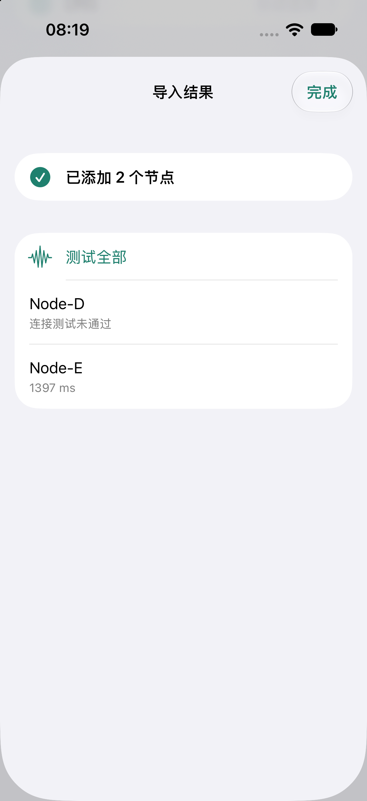

# iPhone 首次导入与 AI 切换节点

2026-11-25，AI 以用户身份试用 Byway 0.1.0（构建 1）。使用当前本地工作区构建，在一台全新的 iPhone 17 模拟器（iOS 27.0）从 App 首页开始。试用场景假设用户已有代理节点，平时在电脑上使用 AI。使用两条本地 SOCKS5 测试链接，A 的端口无服务，B 可发出外部 HTTPS 请求。

| 用户预期 | 操作 | 看到的结果 |
|---|---|---|
| 我有两条链接，想一次导入并看到结果。 | 点首屏「添加节点」，粘贴两条链接，点「导入」。 | 返回首页，卡片显示 Node-A 及「连接」。向下越过路由、DNS、私网、流量与订阅，展开「未分组」后确认两条都已导入。 |
| 我想试试当前节点能否连接。 | 点首页「连接」。 | App 提示「请在 iPhone 真机上启动代理隧道。」随后改用离线测速。 |
| 我想一眼看出哪条能用。 | 在节点区点「测试全部节点延迟」。 | Node-A 显示「连接测试未通过」，Node-B 显示延迟和出口 IP。 |
| 我想把找可用节点和切换交给电脑上的 AI。 | 从首页底部进入「AI 控制」，打开「允许局域网控制」，再下滑找到「复制地址和访问令牌」。按复制内容调用 App 提供的 API 指南。 | 首次设置要经过设备资料、授权开关和管理网页，复制按钮在页面下方。已复制内容包含引导 AI 读取指南的句子。 |
| 我想确认 AI 实际切到了哪条。 | 依指南读取状态和节点，分别执行 HTTPS 测试，选中可用的 Node-B 后重新读取状态，再回首页。 | 接口返回 200，状态及首页都从 Node-A 变为 Node-B，VPN 仍显示「未连接」。调用日志记录了测试失败、测试成功及切换请求。 |

**试用决定。** 我愿意保留 Byway，在需要让电脑上的 AI 帮手机排查网络时用。第一次导入后，我容易以为只加进去了首页上的一条。完成导入后能直接看到「2 个节点」和测速入口，会让我更快走到有用的结果。要把 Byway 换成常用代理，我还需要在真机确认切换后原先打不开的应用能恢复访问。

本机试用证据存于 `.build/user-trial.x1FoDuU1/`，包含首页、展开后的节点列表、AI 复制入口、调用日志、切换接口回执和切换后的首页。AI 控制调用经模拟器的本地回环地址进行，跨设备访问、锁屏控制及 VPN 流量恢复留待真机试用。

## 导入结果页复测

2026-11-25，产品修复后的本地构建仍为 Byway 0.1.0（构建 1）。AI 在 iPhone 17 模拟器（iOS 27.0）粘贴两条测试链接，导入结果页立即显示「已添加 2 个节点」和两个节点名称。点「测试全部」，同页显示一条连接测试未通过和一条延迟。点「完成」回到首页。

- 无效输入保留原文，可在原处修改后重试。混合输入显示新增、已有和跳过各一条，测速进度为两条，已有的其他节点未计入本次测试。
- iPad（A16）模拟器（iPadOS 27.0）导入测试订阅，显示两个已保存节点和一条跳过的记录，点「完成」回到节点列表。相机入口实际打开，模拟器提示相机暂不可用。

## 三轮用户与产品研发交替打磨

2026-11-25，独立用户 Agent 连续在同一台 iPhone 17 模拟器（iOS 27.0）试用。产品研发 Agent 每轮根据操作反馈改一处，使用 Byway 0.1.0 的本地构建交接。

| 轮次 | 用户做到哪一步 | 产品改动与回读 |
|---|---|---|
| 1 | 逐条导入后，要下滑、测试并进节点详情，才把可用的 Node-B 选为出口。 | 导入结果页提供「使用此节点」。下一轮独立复测时，用户测通 Node-C，原地选用并看到「已选为出口」，重启后首页仍是 Node-C。 [选用结果](../ui-examples/手机节点管理/iphone-17-ios27-选用节点.png) |
| 2 | 进入「AI 控制」后，找不到要交给电脑 AI 的内容，转进了需要填写参数的中继设置。 | 在授权开关处说明接入用途，地址就绪后可直接复制接入指令。下一轮独立用户实际开启、复制并读取 App 提供的指南，通过 API 测试 A 和 B 并选中 B。 [复制入口](../ui-examples/手机节点管理/iphone-17-ios27-复制指令.png) |
| 3 | API 回读 Node-B 已选中，用户回到手机的「AI 控制」想看切换结果。当时 VPN 未连接，本机管理网页不可用。 | 原页显示「已选代理节点」和「VPN 状态」。最终复测从 B 测通并切到 C，App 原地更新为 Node-C，VPN 仍显示「未连接」。 [同页回读](../ui-examples/手机节点管理/iphone-17-ios27-出口回读.png) |

AI API 通过模拟器回环地址实测。真机跨设备访问、锁屏时的控制与实际 VPN 流量仍沿用[真机验收](../../ROADMAP.md#近期迭代--iphone-和-ipad-真机验收)。
